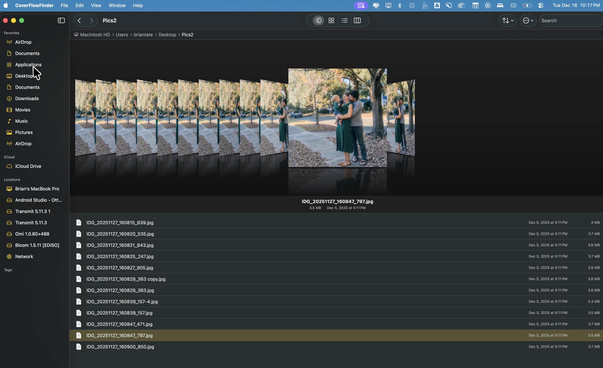

# Flow Finder

A beautiful macOS file browser that brings back the classic Cover Flow view from older versions of Finder.



## Features

- **Cover Flow View** - Browse your files with the iconic 3D carousel effect, complete with smooth animations and reflections
- **Multiple View Modes** - Switch between Cover Flow, Icons, List, Columns, and Dual Pane views
- **Dual Pane Mode** - Two independent file browsers side by side for easy file management
- **Quad Pane Mode** - Four independent panes for rapid comparison and organization
- **Quick Look Integration** - Press Space to preview any file with Quick Look
- **Full File Browser** - Navigate your entire file system with a familiar Finder-like interface
- **Sidebar Navigation** - Quick access to Favorites, iCloud, and mounted volumes
- **Sorting & Search** - Sort files by name, date, size, or kind; search to filter files instantly
- **Archive Browsing** - Browse ZIP, RAR, 7z, TAR and other formats, including passwords, nested archives, multipart sets, Quick Look, thumbnails, single or batch extraction, and ZIP / 7z creation
- **Clipboard Operations** - Copy, Cut, Paste, and Duplicate files with keyboard shortcuts
- **Context Menus** - Right-click for quick access to file operations
- **Type-Ahead Search** - Start typing to jump to matching files instantly

## Requirements

- macOS 15.0 (Sequoia) or later
- Apple Silicon or Intel Mac

## Installation

### Download
Download the latest DMG from the [Releases](https://github.com/elliotttate/CoverFlowFinder/releases) page.

### Build from Source
1. Clone the repository:
   ```bash
   git clone https://github.com/elliotttate/CoverFlowFinder.git
   ```
2. Open `FlowFinder.xcodeproj` in Xcode 26 or later
3. Build and run (⌘R)

## Development

See [DEVELOPMENT.md](DEVELOPMENT.md) for architecture details and how to add a new view mode.

## Usage

### Navigation
- **Click** on a cover to select it
- **Double-click** or press **Return** to open files/folders
- **Arrow keys** to navigate between items
- **Scroll wheel** for smooth momentum scrolling through covers

### Archives
Double-click a supported archive to browse it. Double-click an archive inside it to continue into that archive; Up and Back return through the nested locations. For a file with an unfamiliar extension, choose **Open as Archive** from the File menu or context menu. Compressed TAR files can be entered through their inner TAR member.

Select files or folders and choose **Compress to ZIP** or **Compress to 7z** in the File menu or context menu. The archive is created in the current folder; a single selection uses its name and multiple selections create `Archive.zip` or `Archive.7z`. Existing archive names receive numbered suffixes. Compression preserves the originals and supports progress, cancellation, and Undo / Redo.

Choose **Extract Archive** in the File menu or context menu to extract here, into a folder named after the archive, or into a folder you choose. With multiple archives selected, choose **Extract to Separate Folders** or **Extract All to One Folder…**. Existing items keep their contents; conflicting output names receive numbered suffixes. Extraction supports progress, cancellation, and Undo / Redo. Passwords are requested for interactive opening or extraction and kept only in the current engine session. Background thumbnails never ask for a password. For multipart archives, keep every volume together and open the first RAR/7z volume or the main `.zip` file.

Quick Look and thumbnails prepare only the selected member. Copying a file or folder out uses private temporary storage, validates the data and paths, and retains download quarantine. Long operations have progress and cancellation. Browsing is read-only.

### Keyboard Shortcuts
| Shortcut | Action |
|----------|--------|
| Space | Quick Look preview |
| Return | Open selected item |
| ← → ↑ ↓ | Navigate items |
| ⌘C | Copy |
| ⌘X | Cut |
| ⌘V | Paste |
| ⌘D | Duplicate |
| ⌘⌫ | Move to Trash |
| ⌘[ | Go back |
| ⌘] | Go forward |
| ⌘⇧N | New Folder |
| A-Z, 0-9 | Type-ahead search |

### View Modes
Use the toolbar buttons or View menu to switch between:
- Cover Flow (default)
- Icons
- List
- Columns
- Dual Pane
- Quad Pane

## Technical Details

### Architecture
- Built with SwiftUI for the main interface
- Native AppKit/Core Animation for the Cover Flow view (for optimal performance)
- QuickLookThumbnailing framework for generating file previews

### Performance Optimizations
- Lazy thumbnail loading with prioritization based on proximity to selection
- GPU-accelerated Core Animation transforms
- Efficient layer management with recycling for smooth scrolling

## License

MIT License - see [LICENSE](LICENSE) for details.

## Acknowledgments

Inspired by the classic Cover Flow view from iTunes and older versions of macOS Finder.
